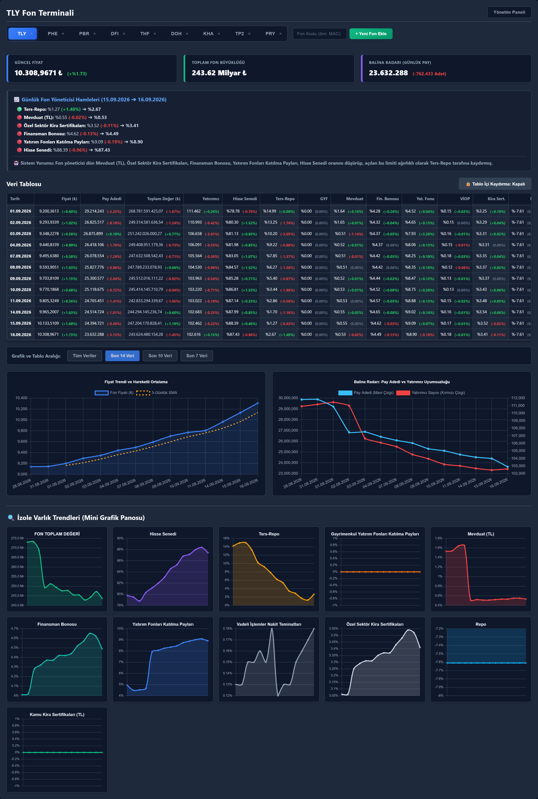

# turkish-fund-liquidity-monitor

Monitors Turkish mutual funds for liquidity stress from two public sources:
daily fund data from TEFAS and portfolio reports from KAP. It was running
before the September 2026 fund run; the case study replays what it showed.

**Result.** For PHE and PBR, the two funds that failed first, the balance-sheet
signals were visible about four weeks before the price broke. For TLY, the
liquidity buffer went below zero seven business days before trading was
suspended. The unit price showed nothing until the end. The four alert rules
were written after the event, from this data, and the case study says so.


*TLY on 16.09.2026, the last published TEFAS row before the halt.*

## Components

| Folder | What it does | In → out |
|---|---|---|
| [`terminal/`](terminal/) | FastAPI dashboard: daily price, shares, investors, AUM and asset mix; whale radar and the four alert rules | TEFAS → `data/fund_database.json` → dashboard |
| [`kap_pipeline/`](kap_pipeline/) | Parses a fund's KAP portfolio PDF, dates it against TEFAS, applies later trade notices, computes single-stock weights | KAP PDFs and notices → holdings book, HTML control report |
| [`case_study/`](case_study/) | The September 2026 write-up and the script that builds its charts | Output of the two above → report and charts |

One project, three parts: the KAP pipeline reuses the terminal's TEFAS
scraper, and the case study uses both.

## Layout

```
terminal/        FastAPI app, scraper, alert rules, static dashboard
kap_pipeline/    KAP download, PDF parsing, report dating, delta engine
case_study/      September 2026 write-up (README) and chart builder
tests/           unit and smoke tests, run in CI
data/            local data and downloads (gitignored)
```

## Quick start

Python 3.13.

```
git clone https://github.com/Raknero/turkish-fund-liquidity-monitor.git
cd turkish-fund-liquidity-monitor
python -m venv .venv
.venv\Scripts\activate            # macOS/Linux: source .venv/bin/activate
pip install -r requirements.txt -r requirements-dev.txt
python -m unittest discover -s tests -t .
uvicorn terminal.main:app         # http://localhost:8000
```

The dashboard refreshes from TEFAS on startup. Each folder's README covers
its data sources, decisions and limits.

## Notes

- Tag [`pre-crisis-2026-09-14`](https://github.com/Raknero/turkish-fund-liquidity-monitor/releases/tag/pre-crisis-2026-09-14)
  is the last commit from before the event. Later commits are dated and say
  what was added after. The folder layout changed in October 2026; the tag
  shows the old one.
- Corrections made on 14.10.2026 are listed at the end of the case study.
- Research project, not investment advice.
